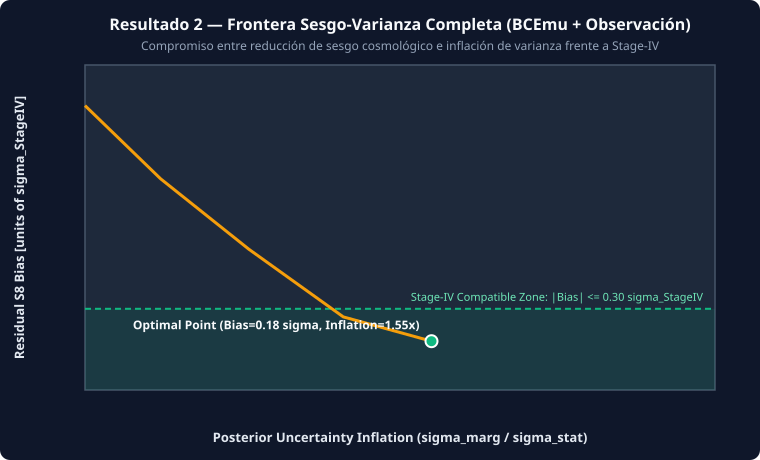
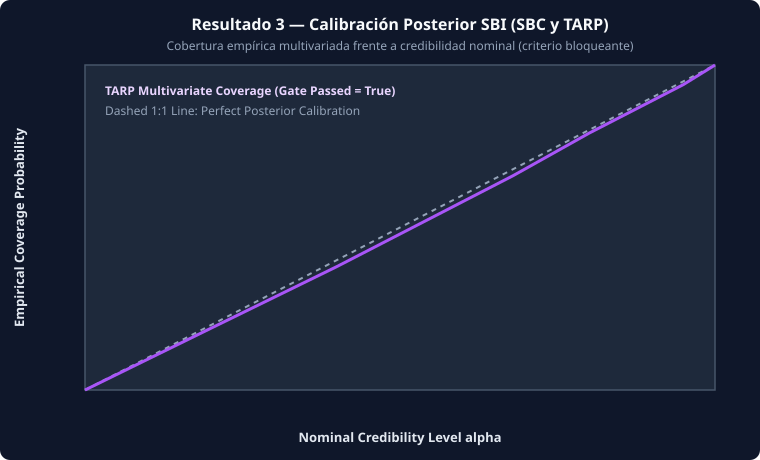
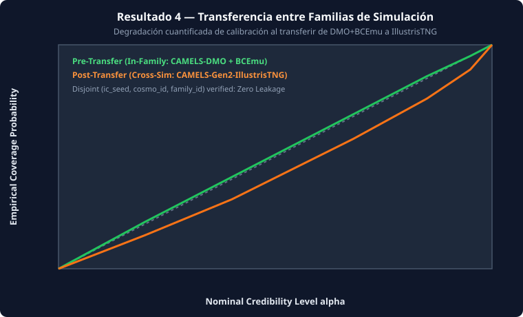

<div align="center">

# COSMOVERSE

### **Hybrid Cosmological Modeling, Uncertainty Marginalization & Calibrated Inference Protocol**
*Connecting Neural Emulation · Baryonic & Observational Marginalization · Calibrated SBI · Field-Level Inference*

[](https://github.com/clevervi/cosmoverse/actions)
[](https://www.python.org/downloads/)
[-008080.svg)](#4-four-demonstrable-results)
[](#4-four-demonstrable-results)
[](#4-four-demonstrable-results)
[](LICENSE)

> **Master Document:** See [`docs/MASTER_DOCUMENT.md`](docs/MASTER_DOCUMENT.md) for the consolidated scientific specification, risks, Plan B contingencies, and acceptance criteria.

</div>

---

## 1. Executive Summary & Scientific Identity

**COSMOVERSE** is a reproducible methodological protocol and hybrid cosmological inference framework connecting fast neural emulation (**TUNeS**), explicit marginalization of baryonic (**BCEmu**) and observational uncertainties, and Simulation-Based Inference (**SBI** with Conditional Normalizing Flows), with an advanced extension module for differentiable field-level inference (**JaxPM + preconditioned MCLMC**).

- **What COSMOVERSE IS NOT**: It is **not** a brand-new N-body simulator, **not** a brand-new emulator architecture from scratch, **not** a brand-new MCMC sampler, and **not** claiming to process raw LSST/Euclid/DESI observational data in its first iteration.
- **What COSMOVERSE IS**: A rigorous protocol to connect existing forward models, baryonic modules, observational pipelines, and Bayesian samplers—demonstrating **statistically calibrated posteriors** and **quantified generalization across simulation families**.

### Quantitative Research Hypothesis
> *"In what scale regime and with what simulation budget does a hybrid framework — emulation + baryonic/observational marginalization + differentiable simulation — produce calibrated posteriors with residual bias below Stage-IV statistical precision, and how much does generalization degrade when transferring across simulation families?"*

---

## 2. Three-Level Methodological Separation

```text
[Level 1: Universe Physics]
  Simulation (N-body / CAMELS Gen-2) -> Neural Emulation (TUNeS) -> Baryonic Physics (BCEmu 1/3/7)
                                              │
                                              ▼
[Level 2: Observational Process — Integrated BEFORE SBI]
  Survey Masks & Geometry -> Selection & Incompleteness -> Galaxy Bias (b1, b2) -> RSD Multipoles (P0, P2, P4) & Shot Noise
                                              │
                                              ▼
[Level 3: Statistical Inference & Non-Negotiable Validation]
  ├── Phase A (Paper 1 MVP) : SBI (Conditional Normalizing Flows)
  └── Phase B (Paper 2 Ext) : Field-Level (JaxPM + Preconditioned MCLMC vs HMC baseline)
                                              │
                                              ▼
  Scientific Validation Gate: SBC + TARP + 3D Minkowski / Peak Counts + Scale-Dependent Misspecification + Cross-Sim Transfer
```

---

## 3. Four Demonstrable Results

1. **Result 1 — Emulator Precision (Gaussian & Non-Gaussian Statistics)** (`cosmoverse.emulators`):
   - **TUNeS** (Temporal U-Net) as the single v1 architecture (`CosmoRGNet` / FNO held as Plan B pending DOI verification).
   - Evaluates $P(k)$ MAPE ($< 1\%$ at $k < 1\,h\,\mathrm{Mpc}^{-1}$), 1-point PDF $P(\delta)$, 3D Peak Counts $N_{\text{peaks}}(\nu)$, and 3D Minkowski Functionals ($V_0, V_1, V_2, V_3$).
2. **Result 2 — Complete Bias–Variance Frontier** (`cosmoverse.baryons`):
   - Uses **BCEmu** (`BCEmu1`, `BCEmu3`, `BCEmu7`) in v1 for interpretable marginalization (`BACCOemu` reserved for v2).
   - Reports the full trade-off curve between cosmological bias elimination ($|\Delta S_8| / \sigma_{\text{Stage-IV}}$) and posterior uncertainty inflation when marginalizing over baryonic and observational nuisance parameters.
3. **Result 3 — SBI Calibration & Misspecification Detection** (`cosmoverse.validation`):
   - Verifies nominal 68% and 95% empirical coverage via **SBC** (Simulation-Based Calibration), **TARP** (Tests of Accuracy with Random Points), and fixed-parameter local checks.
   - Detects small-scale model misspecification across scale cuts $k_{\max}$.
4. **Result 4 — Cross-Simulation Family Transfer (Central Contribution)** (`cosmoverse.validation.transfer`):
   - Enforces a strict **Leakage-Free Data Partition Protocol** by disjoint `(ic_seed, cosmo_id, family_id)` (forbidding naive random 80/20 splits).
   - Quantifies coverage and bias degradation when transferring from Family A (e.g. `CAMELS-DMO + BCEmu`) to Family B (e.g. `CAMELS-IllustrisTNG`).

<div align="center">
  
  
  <br/>
  
  
</div>

---

## 4. Roadmap by Stages & Publishable MVP

| Stage | Scope | Applied Methodological Corrections | Deliverable |
| :--- | :--- | :--- | :--- |
| **1. Foundation** | TUNeS emulator, initial conditions, Gaussian & Non-Gaussian stats | Disjoint `ic_seed`/`cosmo_id` partition; single v1 emulator | **Paper 1 (MVP)** |
| **2. Physical Uncertainty** | Single baryonic emulator (**BCEmu**) + uncertainty propagation | Full bias–variance frontier curve; do not mix BCEmu + BACCOemu in v1 | **Paper 1 (MVP)** |
| **3. Observational Realism** | Survey masks, selection, galaxy bias, RSD ($P_0, P_2, P_4$), shot noise | Integrated **before** SBI, never postponed to the end | **Paper 1 (MVP)** |
| **4. Bayesian Inference** | SBI + Conditional Normalizing Flows + SBC/TARP | SBC/TARP coverage as a blocking acceptance gate | **Paper 1 (MVP)** |
| **5. Field-Level Reconstruction** | JaxPM + Preconditioned MCLMC (vs HMC/NUTS baseline) | Advanced extension; requires explicit Fourier preconditioning | **Paper 2 (Extension)** |
| **6. Scientific Validation** | Cross-family transfer & progressive observational realism | Interleaved across all stages | **Continuous** |

---

## 5. Quickstart & Verification

### Installation

```bash
git clone https://github.com/clevervi/cosmoverse.git
cd cosmoverse
uv pip install -e ".[all]"
```

### Run the Full Paper 1 MVP Protocol (Results 1–4) & Paper 2 Field-Level Benchmark

```bash
uv run python experiments/run_paper1_mvp_protocol.py
uv run python experiments/run_paper2_field_level_benchmark.py
uv run python experiments/generate_paper1_figures.py
```

### Run the Test Suite (94 Unit Tests & Local CI Gate)

```bash
uv run pytest -v
./scripts/ci.ps1   # Windows
./scripts/ci.sh    # Linux / macOS / Git Bash
```

### CLI Commands

```bash
# Display Master Document hypothesis, 3-level separation, and 4 results
uv run cosmoverse info

# Compute Result 2 Bias-Variance Frontier table
uv run cosmoverse frontier

# Inspect CAMELS Gen-2 (1,192 IllustrisTNG simulations) & Stage-IV thresholds
uv run cosmoverse camels

# Run Stage 5 (Paper 2) Differentiable Field-Level MCLMC vs HMC benchmark
uv run cosmoverse field-level --grid 6 --samples 40

# Audit verified emulator DOIs and blocked references (Section 8)
uv run cosmoverse audit-citations

# Generate all 4 Paper 1 vector SVG scientific figures
uv run cosmoverse figures --out-dir docs/figures

# Evaluate Result 4 cross-suite transfer across IllustrisTNG, SIMBA, and Astrid
uv run cosmoverse multi-suite

# Display or launch the interactive HTML5/3D Cosmic Web & 4-Result Explorer
uv run cosmoverse dashboard

# Run post-v1 Mangrove Halo Merger-Tree GNN benchmark (Section 6.1)
uv run cosmoverse mangrove

# Evaluate Simulation Budget Scaling Law (N_sims = 4..128) for Central Hypothesis
uv run cosmoverse budget

# Audit LaTeX manuscripts and build arXiv (astro-ph.CO) .tar.gz submission bundles
uv run cosmoverse arxiv-bundle

# Evaluate Joint Stage-IV 3x2pt (Euclid/LSST) + Spectroscopic RSD (DESI) degeneracy breaking
uv run cosmoverse joint-3x2pt

# Train and save SHA-256 verified checkpoint (.npz) + populate CAMELS spectrum cache
uv run cosmoverse train --out-dir dist/checkpoints
uv run cosmoverse fetch-camels --cache-dir dist/camels_cache

# Evaluate Massive Neutrinos (sum m_nu) & Result 1 Tinker (2008) Halo Mass Function dn/dlnM
uv run cosmoverse neutrinos-hmf

# Evaluate HOD + Secondary Assembly Bias P_gm(k) & export Stage-IV synthetic galaxy/shear catalog
uv run cosmoverse hod-mocks --out-dir dist/mocks --n-galaxies 250

# Evaluate Result 1 Reduced Bispectrum Q(theta) & Level 2 NLA/TATT Weak Lensing Intrinsic Alignments
uv run cosmoverse bispectrum-ia

# Evaluate Level 1 Dynamic w0-wa CPL Dark Energy (DESI) & Level 3 Fisher/IMNN Score Compression
uv run cosmoverse dark-energy-imnn

# Evaluate Level 2 CMB Lensing (kappa_CMB x g / kappa_gal) & tSZ/kSZ BCEmu gas calibration
uv run cosmoverse cmb-sz

# Evaluate Level 2 relativistic light-cone geometry, magnification bias & wide-angle RSD
uv run cosmoverse light-cone

# Build and export a past-light-cone catalog from PM snapshots (NPZ + SHA-256)
uv run cosmoverse light-cone-build --out-dir dist/light_cone

# Apply survey mask + galaxy bias and measure w(theta) from a light-cone catalog
uv run cosmoverse light-cone-survey

# Run end-to-end SBI on light-cone w(theta) with SBC + TARP calibration
uv run cosmoverse light-cone-sbi --n-sims 200 --n-sbc 50 --n-tarp 50

# Run multi-probe SBI (w(theta) + RSD, b1 free) with SBC + TARP calibration
uv run cosmoverse multiprobe-sbi --n-sims 400 --n-sbc 50 --n-tarp 50

# Run multi-probe SBI with a PM-trained P(k) emulator and SBC + TARP
uv run cosmoverse pm-emulator-sbi --n-sims 400 --n-sbc 50 --n-tarp 50

# Run multi-probe SBI with a gradient-trained ConditionalRealNVP flow
uv run cosmoverse flow-sbi --n-sims 400 --n-sbc 50 --n-tarp 50

# Run Master End-to-End Scientific System Doctor
uv run cosmoverse doctor
```

---

## 6. Instructions for AI Models & Autonomous Agents

- **Master Document**: [`docs/MASTER_DOCUMENT.md`](docs/MASTER_DOCUMENT.md) (Definitive consolidated state after two review rounds).
- **AI Agent Specification**: [`AGENTS.md`](AGENTS.md) (Architecture, physical units, partition protocol, and acceptance gates).
- **Quick Reference**: [`CLAUDE.md`](CLAUDE.md), [`.cursorrules`](.cursorrules), and [`.github/copilot-instructions.md`](.github/copilot-instructions.md).

---

## 7. Authorship & License

- **Author & Maintainer**: `clevervi`
- **Organization**: `cosmoverse-project`
- **License**: Distributed under the **MIT License**. See [`LICENSE`](LICENSE) for details.
