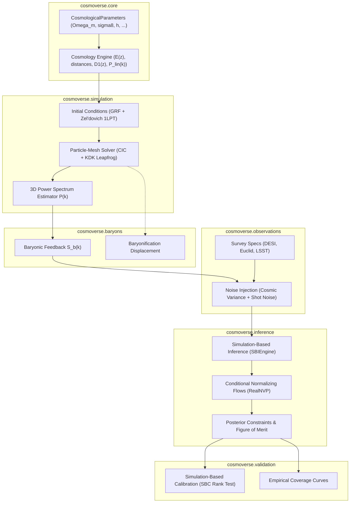

# Architecture & Data Flow

COSMOVERSE is structured as a modular research monorepo designed for computational cosmology. It unifies forward simulation, neural surrogate emulation, observational survey modeling, and Bayesian parameter inference.

---

## 1. High-Level Flowchart

---

## 2. Module Boundaries & Responsibilities

1. **`cosmoverse.core`**:
   - Zero-dependency physics and math layer.
   - Calculates Hubble parameter, comoving distance, angular diameter distance, linear growth factor $D_1(z)$, and Eisenstein & Hu (1998) transfer functions with baryon oscillations.
   - Strictly validated with Pydantic.

2. **`cosmoverse.simulation`**:
   - Particle-Mesh (PM) N-body simulation engine.
   - Generates 3D Gaussian random fields $\delta(\vec{k})$ on periodic grids.
   - Computes displacement fields $\vec{\Psi}_1(\vec{q})$ and moves particles using Zel'dovich 1LPT.
   - Cloud-in-Cell (CIC) mass assignment and force interpolation.
   - Binned spherical estimator for the 3D matter power spectrum $P(k)$.

3. **`cosmoverse.emulators`**:
   - 3D Fourier Neural Operators (FNO) parameterizing Fourier convolution kernels.
   - Multi-scale residual 3D CosmoUNet architectures.
   - Log-space power spectrum loss functions and cross-correlation coefficient $r(k)$ diagnostics.

4. **`cosmoverse.baryons`**:
   - Models the redistribution of matter due to AGN feedback and supernova winds.
   - Generates baryonic suppression ratio $S_b(k) = P_{\text{hydro}}(k) / P_{\text{dmo}}(k)$.
   - Field-level baryonification displacement filters.

5. **`cosmoverse.observations`**:
   - Defines telescope parameters for DESI (spectroscopic), Euclid (space-based), and LSST / Rubin (ground-based photometric).
   - Generates realistic noise: Gaussian cosmic variance and Poisson galaxy shot noise.

6. **`cosmoverse.inference`**:
   - Simulation-Based Inference (SBI) / Neural Posterior Estimation (NPE).
   - Multi-layer Conditional RealNVP normalizing flows for conditional density estimation $q_\phi(\theta \mid x)$.
   - Microcanonical Hamiltonian Monte Carlo (MCLMC).
   - Figure of Merit (FoM) and tension metrics.

7. **`cosmoverse.validation`**:
   - Simulation-Based Calibration (SBC) rank statistics with Kolmogorov-Smirnov uniformity tests.
   - Empirical coverage analysis across nominal credible levels.
   - Latin Hypercube benchmark designs for CAMELS simulations.
